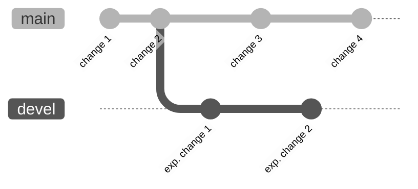

# Homework 3: Git

**Last update:** 20261116-1

**Challenge #TBI:** As a starting point for this challenge, we take the following current situation in the project development:

Before continuing with development on the 'main' branch, the developer realizes that the commit 'exp. change 1' on the 'devel' branch is validated and ready to be integrated into the 'main' branch, and in fact it's desperately needed on the 'main' branch before further development can continue. On the other hand, the commit 'exp. change 2' on the 'devel' branch is still under scrutiny and is not ready yet.  

Write down the Git commands to achieve the following:

1. Only the commit 'exp. change 1' from the 'devel' branch is incorporated into the 'main' branch;
2. Mistakenly, the developer repeats Step 1 also for the still erroneous commit 'exp. change 2', only to realize that after that the version of the project on the 'main' branch can no longer be compiled. How to revert this step entirely, i.e. how to bring the status of the Git repository to the state it was in before this mistake was made; 
3. At some point later, after further development on both 'main' and 'devel' branches, all commits from the 'devel' branch are validated and ready to be incorporated into the 'main' branch, but without duplicating the ones already incorporated in Step 1. How to achieve that?
4. After all commits from the 'devel' branch are incorporated into the 'main' branch, how would you delete the 'devel' branch? In general, is such deletion of the 'devel' branch recommended at that point (+ can you elaborate a bit on your answer)?

**Challenge #TBI:** **Recovery from deletion.** In this challenge, various recovery scenarios are presented when one intentionally or accidentally deletes something in the Git repository, and needs it later. Outline the procedure and write down the concrete Git commands to recover from the following situations: 

1. A file was mistakenly deleted in the current working tree — how to recover its content to the content when that file was last:
    - staged;
    - committed.

2. A file was intentionally deleted, and that deletion was committed. A few weeks later, after several new commits, it suddenly became clear that the file is actually still needed. How to recover its content as it was before it was deleted?

3. If the entire branch was deleted mistakenly, how can it be recovered?
4. The hard disk hosting the local Git repository is broken beyond repair. Luckily and prudently, you host the same project online (e.g. on GitHub or GitLab) and regularly push and pull your commits. How do you continue local project development on a new hard disk? 

